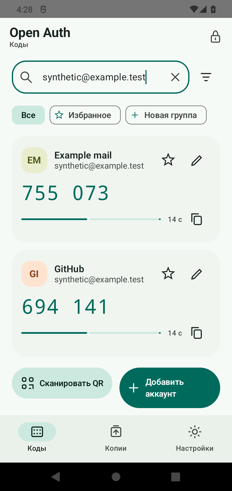
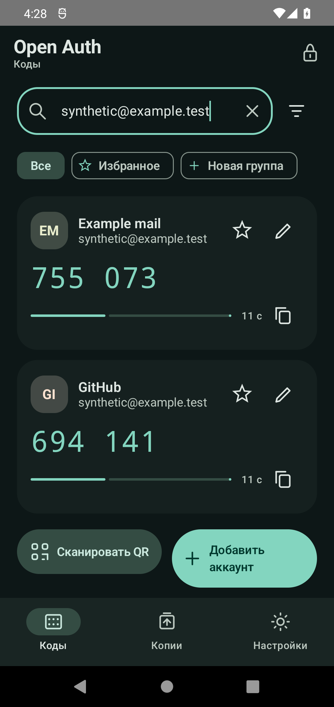
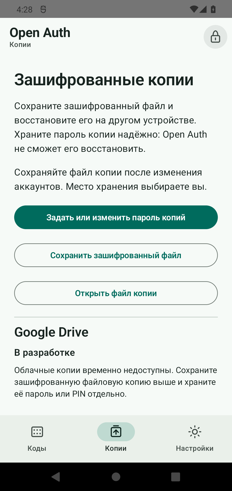

  

# Open Auth

**Ваши коды. Ваше устройство.**

Свободный аутентификатор для Android 12 и новее. Храните коды двухфакторной
аутентификации на телефоне и создавайте переносимые зашифрованные файловые копии.

Аккаунт Open Auth не нужен. У приложения нет собственного сервера, аналитики,
рекламы и платных функций. Локальные коды и файловые копии работают без Google.

## Возможности

- **TOTP и HOTP.** Коды по времени или счётчику, 6 или 8 цифр; для TOTP —
  SHA-1, SHA-256 и SHA-512, для HOTP — SHA-1.
- **Быстрое добавление.** QR-коды формата `otpauth`, ключ Base32 вручную
  и QR-коды переноса Google Authenticator с предварительным просмотром.
- **Порядок в аккаунтах.** Поиск, избранное, группы и сортировка.
- **Локальная защита.** AES-256-GCM и Android Keystore с системной
  аутентификацией; блокировка при уходе из приложения.
- **Переносимые копии.** Зашифрованный файл `.oab` под отдельным паролем
  или PIN, восстановление с объединением или заменой.
- **Google Drive — в разработке.** Модуль сохранён в исходном коде,
  облачные операции временно выключены во всех сборках.
- **Светлая и тёмная темы.** Системное оформление, русский и английский интерфейс.

## Интерфейс

  
  
  

Снимки версии 1.0.0 сделаны при масштабе шрифта 100% с демонстрационными
аккаунтами. Интерфейс также поддерживает крупный шрифт,
светлую и тёмную темы, анимации учитывают системные настройки.

## Установка и первый запуск

Версия **1.0.0 stable** для Android 12 и новее доступна в
[Releases](https://github.com/AnoY606-git/OpenAuth/releases/tag/v1.0.0).
Скачайте `OpenAuth-1.0.0.apk`. Выпуск подписан постоянным сертификатом
Open Auth; рядом опубликована контрольная сумма SHA-256.

При переходе с **0.1.0 preview** сначала сохраните зашифрованный файл `.oab`
через системный выбор файла в папку вне данных приложения и проверьте его
открытие правильным паролем. Preview использовала тестовый сертификат,
поэтому Android не установит stable поверх неё. Только после проверки
копии удалите preview, установите stable и восстановите аккаунты из файла.
Последующие stable-версии смогут обновляться с сохранением данных.

Для первого запуска задайте блокировку экрана Android, затем создайте
хранилище и подтвердите личность в системном окне. Добавьте аккаунт из
настроек двухфакторной аутентификации нужного сервиса. Сразу сохраните
зашифрованную копию и её пароль отдельно от телефона.

Google Drive временно недоступен: подключение аккаунта, отправка и
восстановление облачных копий выключены. На вкладке «Копии» отображается
статус «В разработке». Используйте зашифрованные файлы `.oab` и храните
пароль или PIN отдельно. Приложение не заявлено как прошедшее независимый
аудит безопасности.

## Подробнее

- [Как пользоваться Open Auth](docs/USER_GUIDE.md)
- [Защита данных и ограничения](docs/SECURITY.md)
- [Статус разработки Google Drive](docs/GOOGLE_DRIVE_SETUP.md)
- [Формат резервной копии](docs/BACKUP_FORMAT.md)

## Лицензия и авторы

Собственный код — **GPL-3.0-only**. Copyright (C) 2026 AnoY606-git and
Open Auth contributors. Полный текст: [LICENSE](LICENSE).

[Авторы](AUTHORS.md) · [Происхождение материалов](ATTRIBUTION.md) ·
[Сторонние компоненты и их условия](THIRD_PARTY_NOTICES.md)
